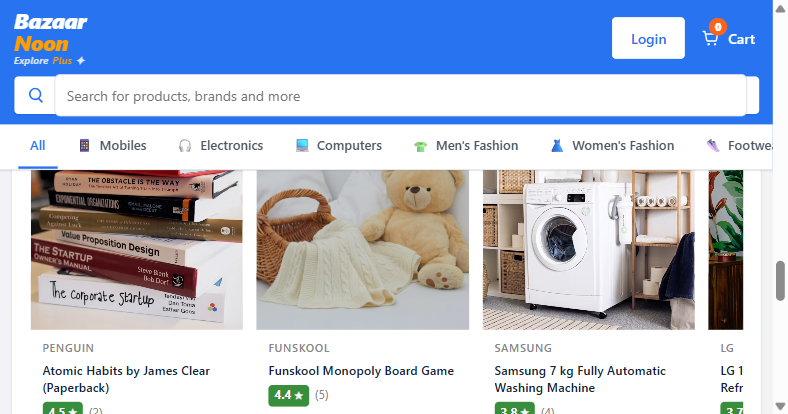
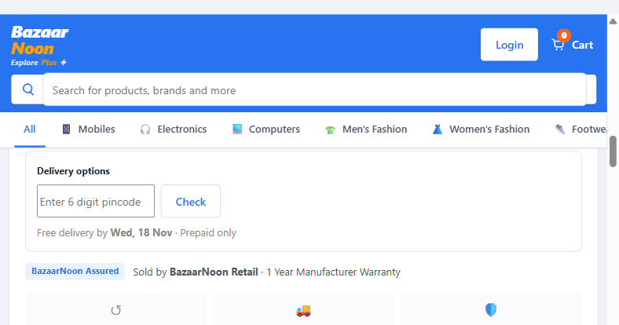
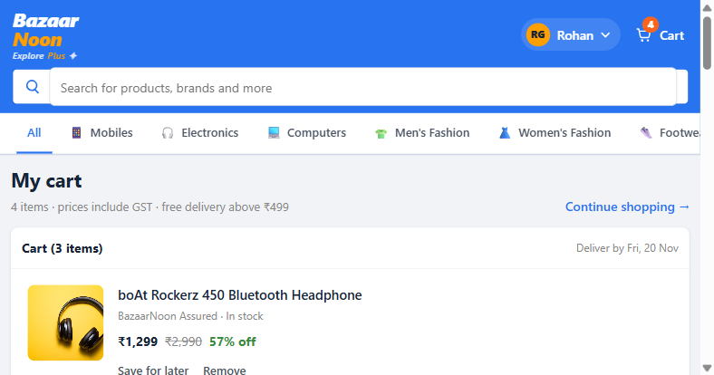
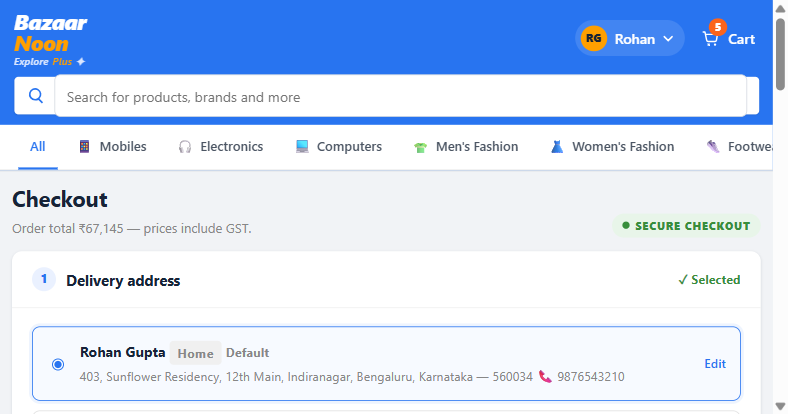
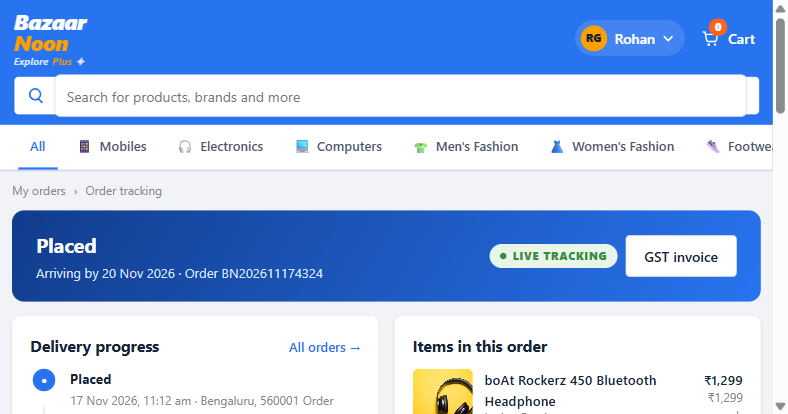
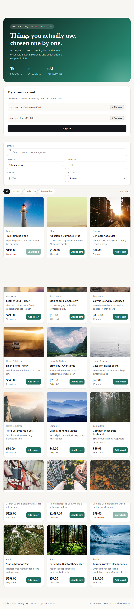

# 🛒 E-Commerce Web Application

A Django-based E-Commerce Web Application developed to provide an online shopping experience with product browsing, shopping cart management, checkout, and order tracking.

The project demonstrates full-stack web development using Python and Django, database management with SQLite, and containerization using Docker.

## 📌 Project Overview

This project is a mini E-Commerce platform designed to simplify online shopping. Users can explore available products, add products to their shopping cart, proceed through checkout, and manage their orders.

The application provides a structured shopping workflow with a Django backend and a responsive web interface.

## ✨ Features

- 🏠 **Homepage:** Browse the available products.
- 🛍️ **Product Listing:** Explore products available in the store.
- 📦 **Product Details:** View individual product information.
- 🛒 **Shopping Cart:** Add and manage products in the cart.
- 💳 **Checkout:** Proceed through the checkout process.
- 📋 **Order Management:** View order details.
- 🗄️ **Database Integration:** Store application data using SQLite.
- 🐳 **Docker Support:** Run the application using Docker and Docker Compose.

## 🛠️ Technologies Used

| Technology | Purpose |
|---|---|
| Python | Backend programming |
| Django | Web application framework |
| SQLite | Database management |
| HTML5 | Webpage structure |
| CSS3 | Styling and layout |
| JavaScript | Frontend interactions |
| Docker | Application containerization |
| Docker Compose | Container orchestration |
| Git & GitHub | Version control and project hosting |

## 📸 Application Screenshots

### 1. Homepage


### 2. Product Details


### 3. Shopping Cart


### 4. Checkout


### 5. Order Details


### 6. Homepage – Additional View


## ⚙️ Installation and Setup

Follow these steps to run the project locally.

### Prerequisites

- Python 3.x
- Git
- pip (Python package manager)

### Step 1: Clone the Repository

```bash
git clone https://github.com/darshan-dev-99/ecommerce-mini.git
```

### Step 2: Navigate to the Project Directory

```bash
cd ecommerce-mini
```

### Step 3: Create a Virtual Environment

```bash
python -m venv venv
```

### Step 4: Activate the Virtual Environment

For Windows:

```bash
venv\Scripts\activate
```

### Step 5: Install Dependencies

```bash
pip install -r requirements.txt
```

### Step 6: Apply Database Migrations

```bash
python manage.py migrate
```

### Step 7: Start the Development Server

```bash
python manage.py runserver
```

Open your browser and visit:

```text
http://127.0.0.1:8000/
```

## 🐳 Running with Docker

This project also includes Docker support.

Make sure Docker Desktop is installed and running.

Execute:

```bash
docker compose up --build
```

To stop the containers:

```bash
docker compose down
```

Refer to the Docker configuration files for the application's specific service and port settings.

## 📁 Project Structure

```text
ecommerce-mini/
│
├── config/                 # Django project configuration
├── store/                  # E-commerce application
├── templates/              # HTML templates
├── static/                 # Static files
├── docker/                 # Docker-related scripts
│
├── Dockerfile              # Docker image configuration
├── docker-compose.yml      # Docker Compose configuration
├── .dockerignore           # Docker ignore rules
├── .gitignore              # Git ignore rules
├── .env.example            # Example environment variables
├── manage.py               # Django management utility
├── requirements.txt        # Python dependencies
│
└── README.md               # Project documentation
```

## 🚀 Future Enhancements

- Integration of a secure online payment gateway.
- Improved product search and filtering.
- Product reviews and ratings.
- Wishlist functionality.
- Enhanced user dashboard.
- Deployment to a cloud hosting platform.

## 🎯 Learning Outcomes

Through this project, I gained practical experience in:

- Building web applications using Django.
- Implementing backend application logic.
- Managing application data using SQLite.
- Developing frontend interfaces.
- Working with Docker and Docker Compose.
- Using Git and GitHub for version control.
- Organizing and documenting a software project.

## 👨‍💻 Author

**Darshan**

GitHub: [@darshan-dev-99](https://github.com/darshan-dev-99)

---

⭐ If you find this project interesting, consider giving it a star!
